# 8-Bit BCD Adder/Subtractor — 두 자리 BCD 가감산기

> 디지털 회로 실험 및 설계 수업 Term Project · **2025.04 – 2025.06** · 5인 팀 (팀장) — 회로 설계·시뮬레이션·제작·디버깅 담당 (기여도 60%)

74 시리즈 TTL IC 12개만으로 만든 **두 자리 BCD(00–99) 가감산기**입니다. DIP 스위치로 두 수를 넣고 토글 스위치로 가산/감산을 고르면 결과가 7-세그먼트 2자리에 10진수로 표시됩니다.
MCU 없이 **조합 논리만으로** 2의 보수 감산, 자리 간 캐리 전달, BCD 보정을 구현했고, Multisim 시뮬레이션 → 브레드보드 → 만능기판 납땜 → 3D 프린팅 케이스까지 완성했습니다.

<p align="center">
  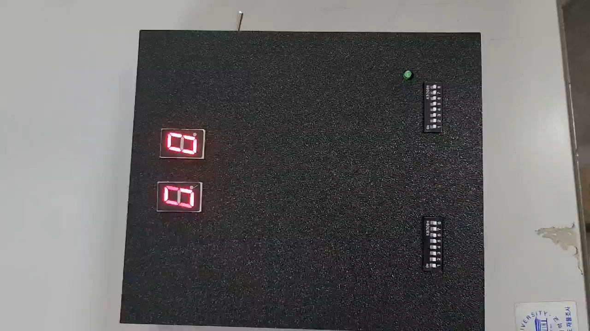
  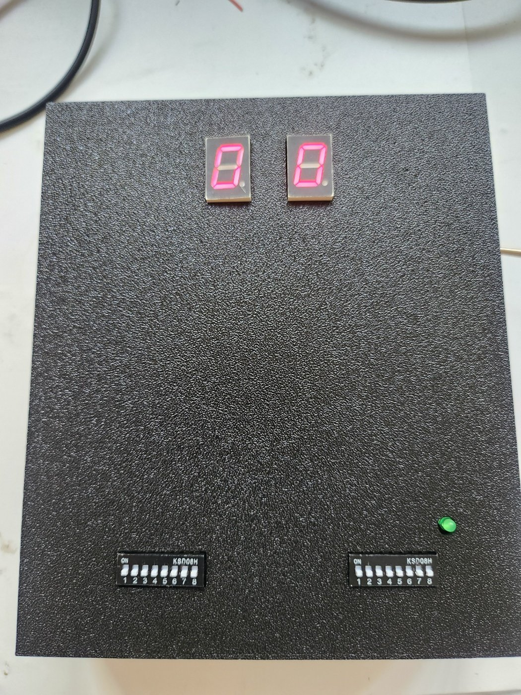
  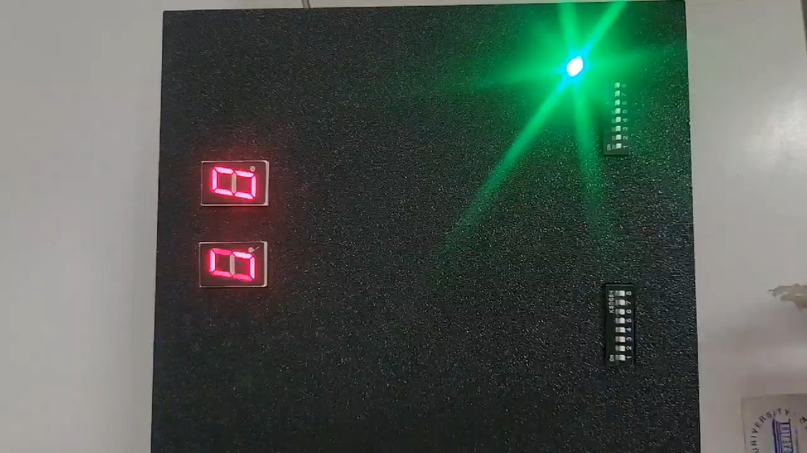
  <br><sub>왼쪽 가산 모드 (LED OFF) · 가운데 완성품 · 오른쪽 감산 모드 (LED ON)</sub>
</p>

| 항목 | 내용 |
|---|---|
| 입력 | DIP 스위치 A, B (각 8비트 = BCD 2자리), 1 kΩ 풀업 |
| 출력 | 7-세그먼트 2자리 (십의 자리 / 일의 자리), 감산 모드 표시 LED |
| 연산 | 74LS83 ×2 직렬 8비트 이진 가감산 + BCD 보정 (74LS83 ×3, 74LS08/32, 74LS153) |
| 감산 방식 | 74LS86 XOR로 1의 보수 + Cin = 1 → **2의 보수 덧셈** |
| 사용 IC | 74LS83 ×5, 74LS86 ×2, 74LS08, 74LS32, 74LS153, 74LS47 ×2 (총 12개) |
| 전원 | DC 잭 + 5 V 어댑터 |

---

## 1. Project Overview

- **목적**: 입출력이 모두 10진수인 두 자리 가감산기를 TTL 로직 IC만으로 구현
- **배경**: 일반 이진 연산기는 결과를 사람이 읽으려면 변환이 한 번 더 필요하지만, BCD 연산기는 계산기처럼 바로 읽을 수 있음
- **해결하려 한 문제**: 한 자리를 넘어 **두 자리 수의 자리 올림(carry)·자리 내림(borrow)과 BCD 보정**까지 다뤄, 가산기·보수기·보정기 같은 기본 블록을 조합한 시스템 수준 설계를 경험하는 것

### 담당 범위

| 파트 | 내용 |
|---|---|
| 프로젝트 관리 | 역할 분담, 일정 관리 (자료조사 → 이론 → 부품 구매 → 시뮬레이션 → 구현 → 납땜) |
| 시뮬레이션 | Multisim 회로 설계 및 가감산·BCD 보정 동작 검증 |
| 부품 구매 | 부품 선정, 수량 산정, 주문 |
| 하드웨어 | 브레드보드 회로 구성, 만능기판 납땜 및 디버깅 |

자료조사·보고서·PPT·케이스 3D 모델링은 팀원이 담당했습니다.

---

## 2. System Architecture

<p align="center">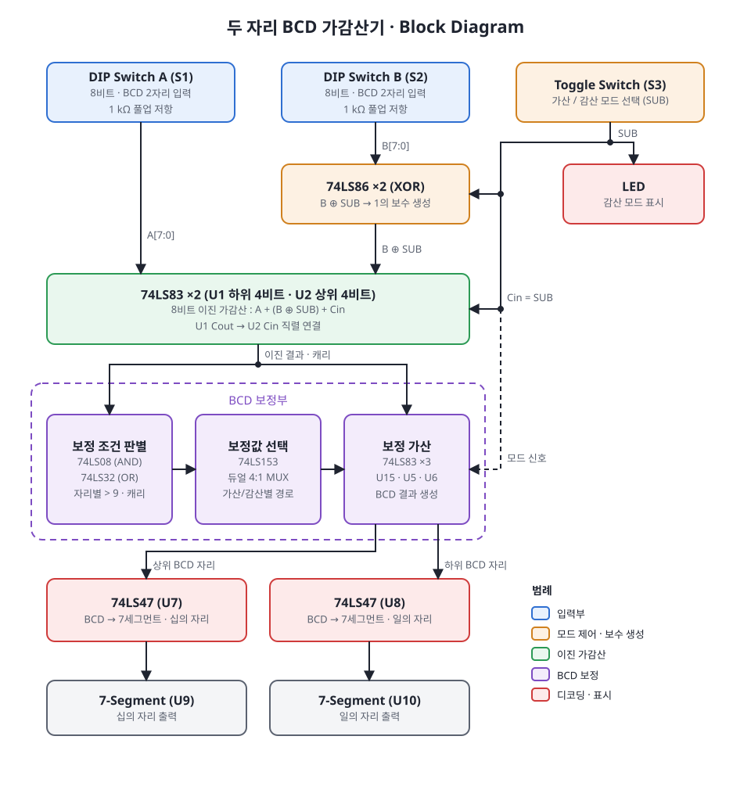</p>

| 블록 | 구성 | 역할 |
|---|---|---|
| 입력 | DIP 스위치 S1(A), S2(B) + 1 kΩ 풀업 | 두 자리 BCD 입력 |
| 모드 선택 | 토글 스위치 S3 | SUB 신호 (0 = 가산, 1 = 감산) |
| 보수 생성 | 74LS86 ×2 | B ⊕ SUB |
| 이진 가감산 | 74LS83 ×2 (U1 하위, U2 상위) | 8비트 이진 덧셈, U1 Cout → U2 Cin |
| 보정 조건 판별 | 74LS08 · 74LS32 | 자리값 > 9, 캐리 발생 여부 |
| 보정 경로 선택 | 74LS153 | 가산/감산 모드에 따른 보정값 선택 |
| 보정 가산 | 74LS83 ×3 (U15, U5, U6) | 보정값을 더해 올바른 BCD로 변환 |
| 표시 | 74LS47 ×2 + 7-세그먼트(Common Anode) ×2 | BCD → 7세그먼트 |

<p align="center">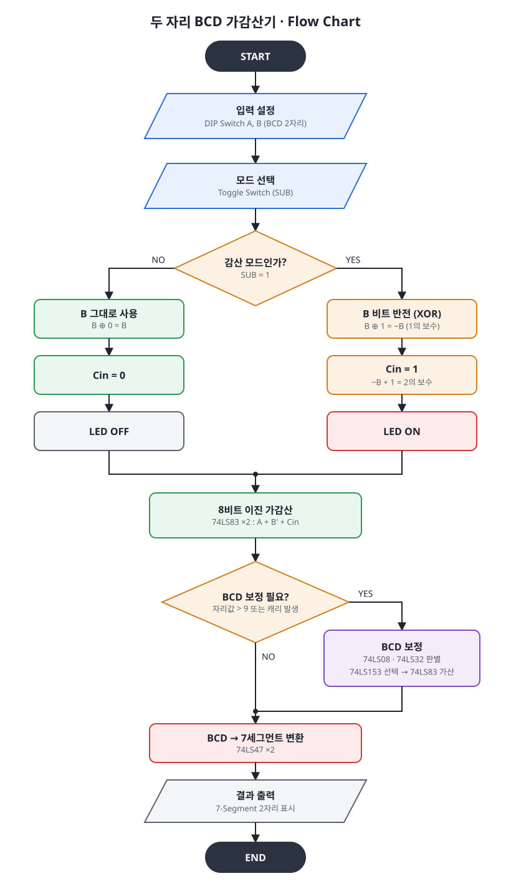</p>

---

## 3. Hardware Design

### 회로도

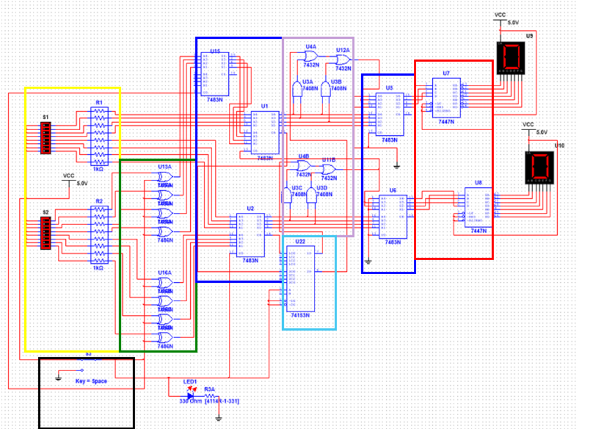

| 색 | 블록 | 구성 |
|---|---|---|
| 노랑 | 입력 제어부 | DIP 스위치 S1(A), S2(B) + 1 kΩ 풀업 저항 |
| 검정 | 가감산 선택 | 토글 스위치 S3 (SUB 신호) |
| 초록 | 보수 연산 및 제어 | 74LS86 ×2 — B ⊕ SUB |
| 파랑 | 4비트 가산기 | 74LS83 — U1(하위)·U2(상위) 이진 가감산, U15·U5·U6 보정 가산 |
| 보라 | 조합 논리 회로 | 74LS08 · 74LS32 — 보정 조건(자리값 > 9, 캐리) 판별 |
| 하늘 | 멀티플렉서 | 74LS153 — 가산/감산 모드에 따른 보정 경로 선택 |
| 빨강 | BCD → 7세그먼트 디코더 | 74LS47 ×2 |

### 부품

| 부품 | 용도 | 수량 |
|---|---|:---:|
| 74LS83 | 4비트 이진 가산기 | 5 |
| 74LS86 | XOR 게이트 (보수 생성) | 2 |
| 74LS08 / 74LS32 | AND / OR 게이트 (보정 조건) | 1 / 1 |
| 74LS153 | 듀얼 4:1 멀티플렉서 | 1 |
| 74LS47 | BCD → 7세그먼트 디코더 | 2 |
| 7-Segment (Common Anode) | 결과 2자리 표시 | 2 |
| DIP 스위치 (8핀) / 토글 스위치 | A, B 입력 / 가산·감산 선택 | 2 / 1 |
| LED | 감산 모드 표시 | 1 |
| 저항 1 kΩ / 330 Ω | 스위치 풀업 / LED 전류 제한 | 16 / 1 |
| IC 소켓 14핀 / 16핀 | IC 장착 | 3 / 4 |
| DC 잭 + 5 V 어댑터 | 전원 | 1 |

### 제작 과정

| 브레드보드 | 만능기판 납땜 | 케이스 3D 모델 (윗면 / 바닥면) |
|:---:|:---:|:---:|
| 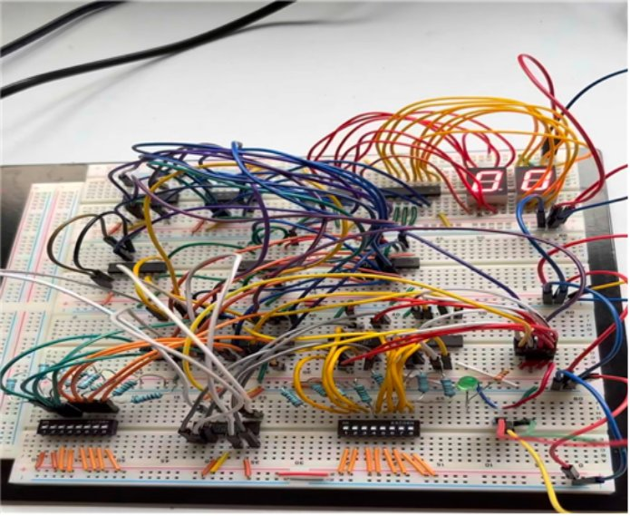 | 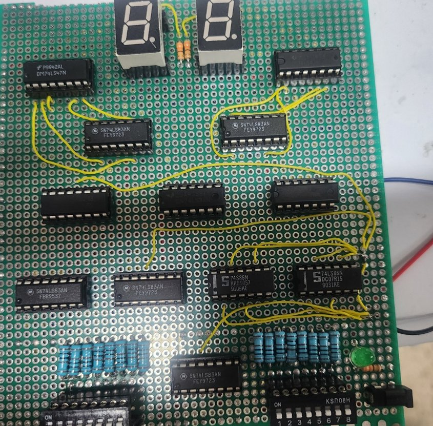 | 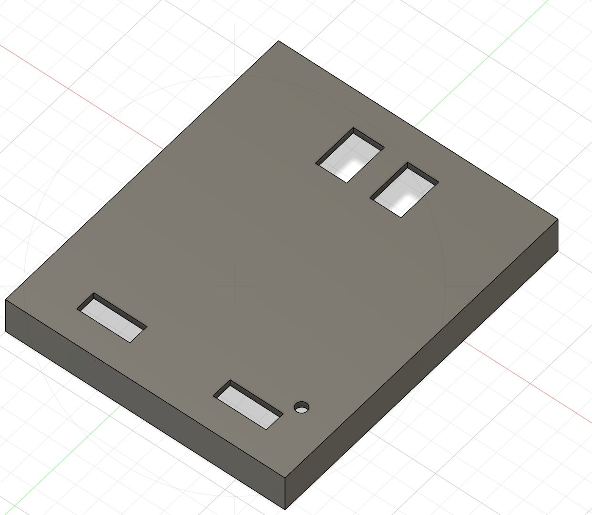 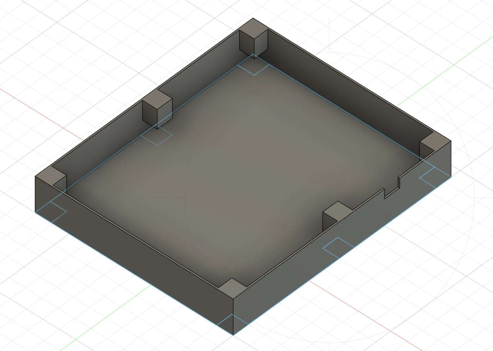 |

- 계산기처럼 작게 만들기 위해 만능기판 한 장에 IC 12개를 촘촘히 배치하고 직접 배선
- 3D 프린팅 케이스 윗면에 7-세그먼트, DIP 스위치, LED 구멍을 내서 조작부만 노출

---

## 5. Implementation

> 펌웨어가 없는 순수 하드웨어 프로젝트라 4장(Firmware & Software)은 생략합니다.

### 감산 (2의 보수)

`A − B = A + (~B + 1)`

| SUB | B ⊕ SUB | Cin | 연산 |
|:---:|:---:|:---:|---|
| 0 | B | 0 | A + B |
| 1 | ~B (1의 보수) | 1 | A + ~B + 1 = A − B |

- B의 각 비트를 SUB 신호와 XOR하면 감산 모드에서만 비트가 반전되고, 같은 SUB 신호를 Cin에 넣어 +1을 처리합니다.
- 74LS83은 4비트 가산기라서 두 개를 직렬로 연결(U1 Cout → U2 Cin)해 8비트 연산을 합니다.

### BCD 보정

- 4비트 이진 덧셈은 16에서 캐리가 나지만, BCD 한 자리는 10에서 올림이 나야 합니다. 그래서 자리별 결과가 9를 넘거나 캐리가 생기면 보정값을 더해 올바른 BCD로 바꿉니다.
- 보정 조건은 74LS08·74LS32 조합 논리로 판별하고, 가산과 감산에서 필요한 보정이 다르기 때문에 74LS153 멀티플렉서로 모드에 따라 보정 경로를 고릅니다.
- 보정 결과를 74LS47로 디코딩해 7-세그먼트에 표시합니다.

### 주요 설계 결정

- **스위치 풀업**: 열린 스위치의 TTL 입력 플로팅을 막기 위해 16비트 입력 모두에 1 kΩ 풀업
- **회로 재구성**: 초기 7개 IC 회로가 실물에서 오동작해 최종 12개 IC 구성으로 다시 설계 ([트러블슈팅 2](#2-시뮬레이션과-실물-동작-차이))

---

## 6. Troubleshooting

### 1. 스위치 입력 플로팅
- **증상**: 브레드보드에서 DIP 스위치를 OFF로 둔 비트가 HIGH/LOW를 오가며 결과가 불안정
- **원인**: 스위치가 열렸을 때 TTL 입력이 어디에도 연결되지 않은 플로팅 상태
- **해결**: 스위치 출력단마다 1 kΩ 풀업 저항(총 16개)을 달아 기본값을 고정

### 2. 시뮬레이션과 실물 동작 차이
- **증상**: 처음 IC 7개로 구성한 초기 회로가 Multisim에서는 정상 동작했지만, 납땜 후에는 다르게 동작
- **원인**: 시뮬레이션에 없는 전기적 특성과 배선·납땜 상태 문제
- **해결**: 회로를 재구성(최종 IC 12개)하고 선 연결을 하나씩 다시 점검

### 3. 십의 자리가 바뀌는 연산에서 출력 오류
- **증상**: `15 − 8`처럼 결과의 십의 자리가 바뀌는 경우 세그먼트에 잘못된 값 표시
- **원인**: 자리 올림/내림이 생길 때의 보정 로직 누락
- **해결**: 캐리 처리 로직을 수정하고 회로 연결을 보완

### 4. 고밀도 배치로 인한 배선·합선 문제 (개선 과제)
- **증상**: IC를 최대한 가깝게 붙여 배치하다 보니 배선 정리가 어렵고 합선 디버깅에 시간이 많이 듦
- **개선 방향**: 만능기판 대신 KiCad로 PCB를 직접 설계 → 다음 프로젝트([ATmega128 POV Display](https://github.com/qetad13/atmega128-pov-display))에서 KiCad PCB로 적용

---

## 7. Performance & Validation

| 단계 | 확인한 연산 | 결과 |
|---|---|---|
| Multisim 시뮬레이션 | 6 + 12, 14 − 8 | **18**, **6** 정상 표시 |
| 브레드보드 | 5 + 8, 12 − 4 | **13**, **8** 정상 표시 |
| 완성품 (만능기판) | 동작 영상 2편 | 스위치 입력 → 결과 표시 확인 |

| | 가산 | 감산 |
|---|:---:|:---:|
| **시뮬레이션** | 6 + 12 = **18**<br>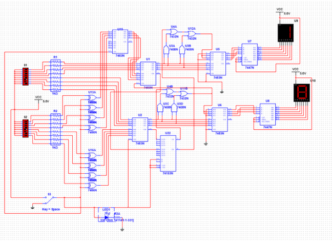 | 14 − 8 = **6**<br>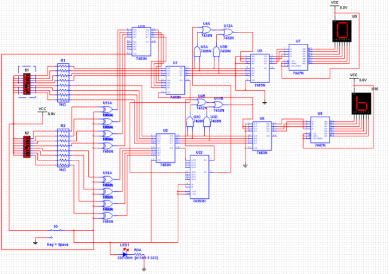 |
| **브레드보드** | 5 + 8 = **13**<br>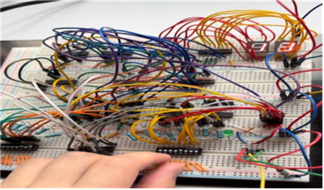 | 12 − 4 = **8**<br>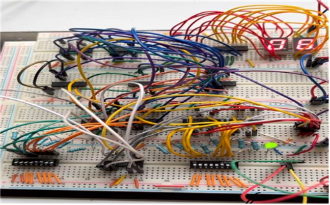 |

| 영상 1 | 영상 2 |
|:---:|:---:|
| <a href="videos/demo_1.mp4">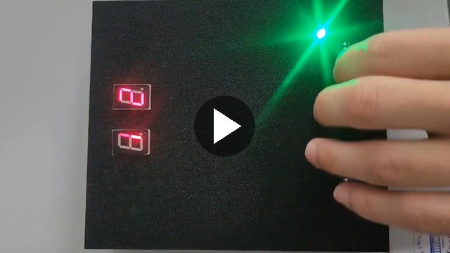</a> | <a href="videos/demo_2.mp4">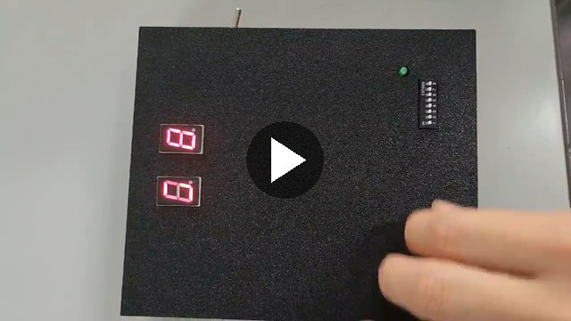</a> |

▶ [`videos/demo_1.mp4`](videos/demo_1.mp4) · [`videos/demo_2.mp4`](videos/demo_2.mp4) — 완성품에서 스위치로 입력하고 결과를 표시하는 모습

**검증 범위**: 기록으로 남은 것은 위의 대표 연산들입니다. 00–99 전체 입력 조합을 체계적으로 시험한 기록은 없고, 결과가 음수가 되는 감산(A < B)의 표시 결과도 기록되어 있지 않습니다. 전파 지연 등 타이밍 측정은 하지 않았습니다.

---

## 8. Limitations & Future Work

- **검증 범위가 좁음**: 대표 연산 몇 개만 기록. 전체 조합 시험표(특히 자리 올림·내림 경계값: 09+01, 99+01, 10−01, 00−01 등)를 만들어 확인할 필요가 있음
- **음수 결과 처리 미문서화**: A < B일 때의 동작(부호 표시, 10의 보수 표시 등)을 정의하고 회로에 반영할 필요
- **만능기판 고밀도 배선**: 수정·디버깅이 어려움 → PCB로 옮기면 신뢰성과 재현성이 좋아짐
- **입력 방식**: DIP 스위치에 BCD를 직접 넣어야 해서 9를 넘는 잘못된 BCD 입력(1010~1111)을 막지 못함

---

## 9. Repository Structure

```
8bit-bcd-adder-subtractor/
├─ circuit/
│  └─ bcd_adder_subtractor_final.ms14   최종 회로 (NI Multisim 14)
├─ docs/                                 블록도 · 플로우차트 (SVG / PNG)
├─ images/                               회로도, 시뮬레이션, 브레드보드, 3D, 완성품 사진
└─ videos/                               동작 영상
```

### 실행 방법

- **시뮬레이션**: NI Multisim 14 이상에서 `circuit/bcd_adder_subtractor_final.ms14` 열기 → 시뮬레이션 실행. S1(A), S2(B) DIP 스위치로 값 입력, **Space** 키로 S3 토글(가산/감산 전환)
- **실물 조작**: 5 V 어댑터 연결 → DIP 스위치로 A, B를 BCD로 입력 → 토글 스위치로 모드 선택 (감산이면 LED 점등)

---

## 기술 스택
`TTL Logic (74LS)` · `NI Multisim 14` · 브레드보드 · 만능기판 납땜

## 라이선스 / 출처
- [MIT License](LICENSE)
- 회로 설계는 팀에서 직접 작성했으며, 블록도·플로우차트는 결과보고서를 바탕으로 다시 그렸습니다.
- 데이터시트: [74LS83](https://www.alldatasheet.co.kr/datasheet-pdf/view/51091/FAIRCHILD/74LS83.html) · [74LS47](https://www.alldatasheet.co.kr/datasheet-pdf/view/51080/FAIRCHILD/74LS47.html) · [74LS153](https://www.alldatasheet.co.kr/datasheet-pdf/view/27384/TI/74LS153.html)
